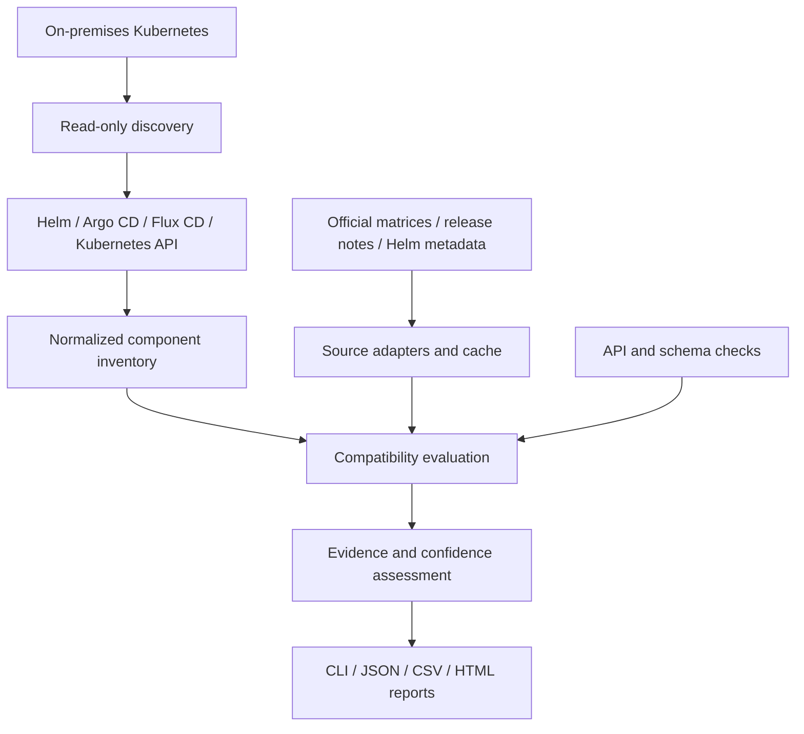

# KubeCompat — Kubernetes Upgrade Compatibility Scanner

> **Project status: proposal only.** This repository contains the project specification; the scanner has not been implemented or released. Features, delivery phases, and CLI commands below describe planned behavior, not existing functionality.
>
> The GitHub repository is named `kubecompact`; the product name is **KubeCompat**, and the proposed executable name is `kubecompat`.

## 1. Objective

Build an open-source, read-only scanner for on-premises Kubernetes that discovers installed components and manifests managed by Helm, Argo CD, Flux CD, Kustomize, and direct Kubernetes deployments. It will compare their actual versions with a target Kubernetes release using existing compatibility matrices, official documentation, release notes, and API deprecation information available on the internet.

The tool must provide **evidence-backed results**, actionable upgrade recommendations, and machine-readable and human-readable reports. A lack of authoritative evidence must produce `UNKNOWN`, not an assumed compatibility verdict.

## 2. Scope

### Included

- Kubernetes distribution, control-plane version, nodes, and architecture discovery.
- Standalone Helm releases: chart name/version, `appVersion`, configured images, release status.
- Argo CD Applications and ApplicationSets: Helm charts, Kustomize, raw YAML, multi-source applications, Git revisions, sync status.
- Flux CD HelmReleases, Kustomizations, GitRepositories, HelmRepositories, OCIRepositories, HelmCharts, and reconciliation status.
- Directly deployed Kubernetes objects, workloads, image references, CRDs, APIService objects, admission webhooks, and relevant API versions.
- Manifest scans from local paths and optionally accessible Git repositories.
- Online lookup of project-specific Kubernetes compatibility matrices, versioned support documentation, chart metadata, and release notes.
- Validation of deprecated/removed APIs and manifest schemas against a selected Kubernetes target.
- CLI output, JSON, CSV, and self-contained HTML reports.

### Out of scope for the MVP

- Modifying Kubernetes objects or performing upgrades automatically.
- Guaranteeing runtime compatibility solely from valid YAML or supported Kubernetes APIs.
- Automatically authenticating to private repositories without explicitly configured credentials.
- Treating inferred compatibility as an authoritative supported version range.

## 3. Proposed Technology Stack

| Layer | Technology |
| --- | --- |
| CLI and core services | Go |
| Kubernetes discovery | `client-go`, discovery and dynamic clients |
| Helm discovery | Helm SDK and release metadata |
| Argo CD and Flux CD | Read-only Kubernetes CRD clients |
| YAML and schema validation | Kubernetes YAML tooling and Kubeconform integration |
| Deprecated API checks | Pluto/KubePug adapters or curated equivalent data |
| Online sources | Official documentation, GitHub API, Helm repositories, Artifact Hub |
| Compatibility rules | Versioned, declarative rules plus source-specific parsers |
| Persistent cache | SQLite |
| Reporting | CLI tables, JSON, CSV, static HTML |
| Validation | Unit tests, fixtures, kind-based integration tests |
| Distribution | Release binaries and container image |

## 4. Architecture



### Inventory data model

Each discovered component should record:

- Cluster, namespace, resource owner, deployment method, and controller.
- Canonical upstream project identity and repository URL.
- Helm chart name, repository, chart version, and chart `appVersion`, when available.
- **Desired version** (GitOps declaration), **deployed version** (last successfully applied revision/release), and **running version** (observed workload images).
- Image tags and, where available, observed immutable image digests.
- Kubernetes resources, API versions, CRDs, and dependencies.
- Provenance of each value, collection timestamp, and confidence.

Avoid double-counting the same component when a Flux HelmRelease appears both in the Flux CRDs and Helm release records. Argo CD Helm applications may not exist as Helm releases because Argo CD normally uses Helm to render manifests and manages their lifecycle itself.

## 5. Compatibility Knowledge Base

### Source precedence

| Priority | Source | Interpretation |
| --- | --- | --- |
| P0 | Explicit official compatibility matrix for the exact product version | High-confidence support or incompatibility evidence |
| P1 | Official version-specific support policy or documentation | High-confidence evidence |
| P2 | Official release notes or upgrade guides | Evidence for requirements and breaking changes |
| P3 | Helm chart `kubeVersion` metadata | Chart-declared constraint; not full runtime assurance |
| P4 | Curated third-party compatibility database | Supporting evidence requiring provenance checks |
| P5 | Automated inference from ambiguous prose | Low confidence; do not automatically mark compatible |

The engine should discover project documentation using known upstream identities, fetch relevant versioned pages, extract structured support statements, normalize Kubernetes version ranges, and cache the extracted rules alongside the **source URL, retrieval timestamp, applicability, and parser version**.

Initial source adapters should cover common infrastructure components such as Cilium, Calico, cert-manager, Argo CD, Flux CD, CoreDNS, ingress controllers, metrics-server, Prometheus Operator, Velero, KEDA, Kyverno, Istio, and storage drivers. Unknown applications still appear in inventory.

### Verdicts

| Verdict | Meaning |
| --- | --- |
| `COMPATIBLE` | Authoritative evidence explicitly supports the installed version on the target Kubernetes version. |
| `INCOMPATIBLE` | Authoritative evidence explicitly excludes the target or identifies an unavoidable incompatibility. |
| `UPGRADE_REQUIRED` | The installed component must be changed first; a compatible replacement is supported by evidence. |
| `NOT_TESTED` | The target is outside documented tested versions, without proof of incompatibility. |
| `UNKNOWN` | Missing, ambiguous, stale, or contradictory evidence prevents a firm determination. |

API/schema validation and component-runtime compatibility are separate checks. A manifest passing schema validation must not by itself produce `COMPATIBLE`.

## 6. Delivery Phases

| Phase | Indicative duration | Work | Exit criteria |
| --- | --- | --- | --- |
| 1. Inventory | Weeks 1–2 | Kubernetes, Helm, Argo CD, Flux CD, and raw resource collectors | Unified inventory with ownership, namespace, source, JSON output |
| 2. Version resolution | Week 3 | Chart `appVersion`, OCI/Helm metadata, desired/deployed/running versions, deduplication | Traceable version records and reproducible fixtures |
| 3. Online evidence | Weeks 4–5 | Official source adapters, structured matrix extraction, GitHub/release notes, SQLite cache | Version-aware rules with URLs and source timestamps |
| 4. Readiness engine | Week 6 | Target-version evaluation, deprecated API checks, CRD/webhook checks, upgrade candidates and prerequisites | Evidence-backed verdicts and clear unknown states |
| 5. Reports and validation | Weeks 7–8 | HTML/CSV/JSON, tests with kind and GitOps fixtures, RBAC, documentation, packaging | Usable MVP binary and security-reviewed read-only operation |

**Estimate:** Eight focused engineering weeks for an MVP, subject to the quality and variety of upstream compatibility sources. Broad project coverage will remain an ongoing maintenance task.

## 7. CLI Proposal

```bash
# Inspect live cluster and GitOps-managed resources
kubecompat scan --all-namespaces --output inventory.json

# Check readiness for a target Kubernetes release
kubecompat check --target-k8s 1.35 --online

# Generate a portable HTML report
kubecompat report --target-k8s 1.35 --format html --output report.html

# Refresh locally cached compatibility evidence
kubecompat db update

# Check manifests without a live cluster
kubecompat scan --manifests ./k8s/
```

These commands are a **proposed interface**, not commands from an existing released binary.

## 8. Report Requirements

Every component row should contain:

| Field | Example or purpose |
| --- | --- |
| Component and namespace | `cert-manager / cert-manager` |
| Managed by | Helm, Argo CD, Flux CD, direct manifest |
| Chart version | Exact installed/resolved chart version, if applicable |
| Application version | Chart `appVersion` or independently identified version, clearly distinguished |
| Running version | Image tags/digests observed in the cluster |
| Target Kubernetes | User-specified target release |
| Assessment | Compatible, Incompatible, Upgrade Required, Not Tested, or Unknown |
| Recommended version | Only when backed by a version-specific support source |
| Explanation | Relevant requirement, removed API, or breaking change |
| Evidence | Clickable official URL, date retrieved, and confidence |

Provide filters by namespace, controller, component, status, and evidence quality. Export the same normalized findings to JSON and CSV for CI systems.

## 9. Security and Operational Constraints

- Use minimum necessary **read-only** Kubernetes RBAC, with a documented list of cluster-scoped resources required.
- Never run `helm upgrade`, `kubectl apply`, `argocd sync`, or `flux reconcile` automatically.
- Avoid collecting Kubernetes Secret values; read release metadata only when authorized and required, and redact any sensitive data from reports.
- Support offline cached evaluation when public sources are temporarily unavailable, identifying stale evidence.
- Rate-limit remote requests, respect GitHub API limits, and permit configured proxies and private certificates.
- Keep private Git/Helm credentials out of logs and exported reports.

## 10. MVP Acceptance Criteria

- [ ] Operates against on-premises Kubernetes using read-only credentials.
- [ ] Discovers Helm releases, Argo CD Applications, Flux HelmReleases/Kustomizations, and directly deployed workloads.
- [ ] Supports Argo CD multi-source applications and relevant Flux source resources.
- [ ] Resolves chart versions, chart `appVersion`, and observed images when the information exists.
- [ ] Differentiates desired, deployed, and running versions; deduplicates resources across collectors.
- [ ] Checks deprecated/removed APIs and manifests against the target Kubernetes version.
- [ ] Retrieves existing official compatibility information over the internet and caches its provenance.
- [ ] Links every compatibility assertion to evidence and distinguishes `NOT_TESTED` from `INCOMPATIBLE`.
- [ ] Suggests compatible upgrade candidates only when source-backed.
- [ ] Outputs CLI, JSON, CSV, and standalone HTML reports.
- [ ] Does not change cluster state or expose confidential manifest data.
- [ ] Passes tests for Helm-only, Argo CD, Flux CD, and mixed-management clusters.

## 11. Primary Risks and Mitigations

| Risk | Mitigation |
| --- | --- |
| Upstream project has no compatibility matrix | Show `UNKNOWN`, retain project identity, allow optional reviewed rules |
| Documentation format or URL changes | Versioned adapters, source health checks, cached evidence |
| GitOps and Helm duplicate inventory | Ownership correlation across CRDs, labels, Helm metadata, and object UIDs |
| Chart version differs from application/runtime version | Separate fields and version provenance |
| Vendor-specific or custom operators | Generic inventory; explicit unknown compatibility |
| Private repositories and mirrored images | Optional credentials and configurable project identity mappings |
| API schema validity differs from operational compatibility | Distinct checks, statuses, and recommendations |
| Rate limiting and intermittent internet access | Local cache, conditional fetches, bounded retries |

## 12. Recommended Build Order

1. Deliver **accurate, deduplicated inventory** before adding any compatibility verdicts.
2. Support **10–15 high-impact infrastructure components** with authoritative online evidence.
3. Add generalized documentation discovery with conservative `UNKNOWN` handling.
4. Deliver polished reports, CI integration, and extensible source adapters.

**Core principle:** The tool should be evidence-driven and auditable. An honest `UNKNOWN` is safer than a false `COMPATIBLE` result.

## License

[MIT](LICENSE).
